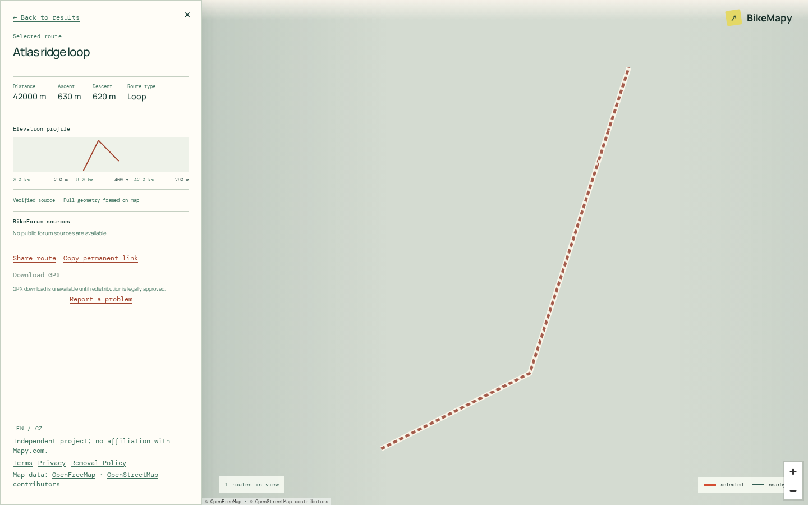
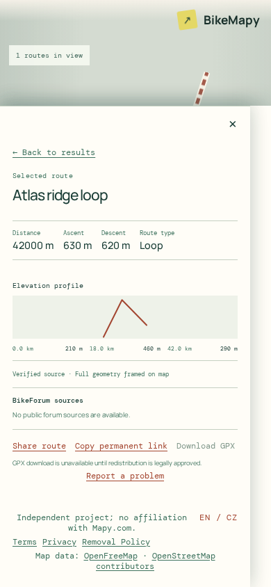

# BikeMapy

BikeMapy is a map-first catalogue of cycling routes shared in BikeForum
discussions. Each route keeps its geometry, its source post and author, and a
link back to the original discussion.

The source is public; the service is not publicly launched yet.





## Features

- React and TypeScript interface with a MapLibre map, a route list, shareable
  URL state, route details and Czech and English translations.
- Versioned Django REST API: paginated search, bounded viewport queries
  (heatmap at low zooms, simplified lines above), route geometry, OpenAPI
  schema and a generated TypeScript client.
- Route catalogue with immutable route versions, source provenance,
  duplicate and variant detection, and an audited moderation history.
- A resumable, rate-limited BikeForum crawler and GPX import, each behind
  deployment flags.
- Owner-only administration through GitHub OAuth, and anonymous route reports
  protected by Turnstile and rate limits.

## Stack

- **Frontend:** React 19, TypeScript, Vite, MapLibre GL JS, `openapi-fetch`,
  pnpm; Cloudflare Pages.
- **Backend:** Python 3.13, Django 5.2, Django REST Framework, GeoDjango,
  Celery, `django-allauth`.
- **Data:** PostgreSQL with PostGIS, Redis.
- **Delivery:** Docker Compose, Nginx, Cloudflare Tunnel, commit-tagged images
  in GitHub Container Registry.

## Run locally

Requirements: Docker with Compose v2, Python 3.13 with
[uv](https://docs.astral.sh/uv/), and Node.js 22 with Corepack.

```sh
cp .env.example .env
docker compose up --build
docker compose exec backend python backend/manage.py migrate
```

The frontend runs at <http://localhost:5173>, the API at
<http://localhost:8000> and its documentation at
<http://localhost:8000/api/docs/>.

```sh
make install    # locked backend and frontend dependencies
make check      # lint, type checks, tests and frontend build
```

CI also runs the PostGIS suite, browser tests, Compose smoke tests, a rollback
rehearsal, a restore drill, CodeQL, Gitleaks and dependency audits.

## Documentation

- [Local development](docs/local-development.md)
- [Architecture](docs/architecture.md)
- [Deployment and operations](docs/deployment.md)
- [Security policy](SECURITY.md) and [contributing](CONTRIBUTING.md)
- Public notices: [privacy](docs/privacy.md), [terms](docs/terms.md),
  [removal policy](docs/removal-policy.md)

## Project history

Until October 2026 this repository also contained an experimental private
game built on Strava activities. It was removed to keep BikeMapy focused on
the route catalogue and continues, together with a bike-fitting prototype, in
separate private repositories.

## License

The source code is MIT licensed (see [LICENSE](LICENSE)). The licence does
not cover third-party maps, routes, GPX files or forum content.
