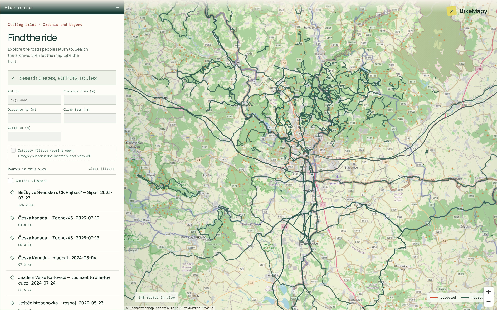
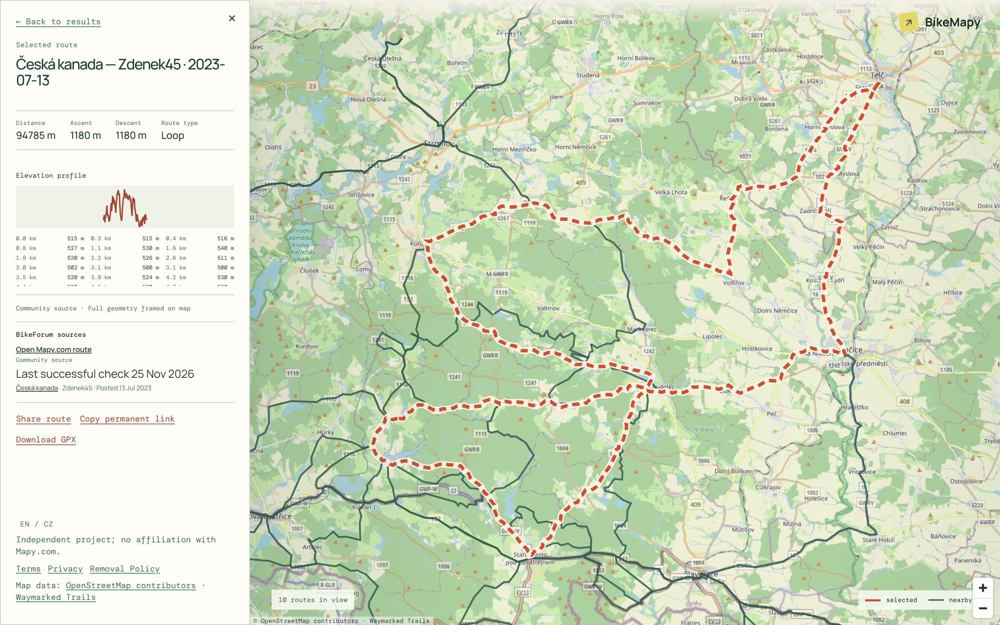
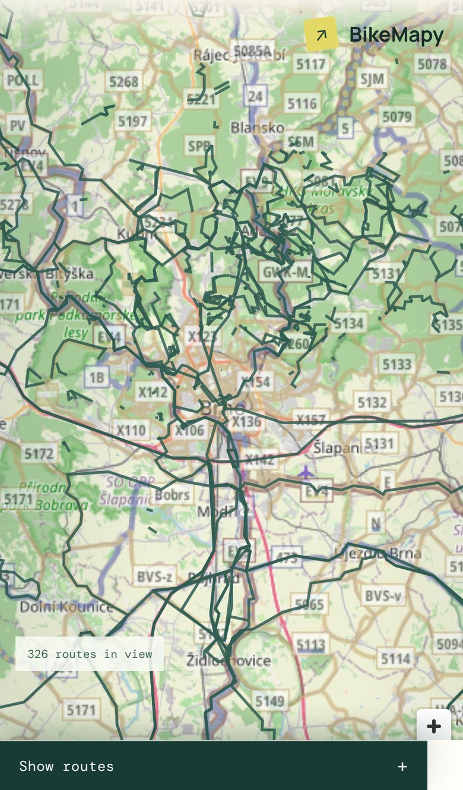
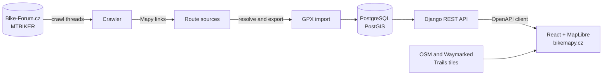

<div align="center">

# BikeMapy

**A map-first atlas of cycling routes shared on Czech cycling forums, each with its source.**

[**bikemapy.cz**](https://bikemapy.cz) · [Architecture](docs/architecture.md) · [Local development](docs/local-development.md) · [Deployment](docs/deployment.md)

[](https://bikemapy.cz)
[](https://github.com/diamond447/BikeMapy/actions/workflows/ci.yml)
[](https://github.com/diamond447/BikeMapy/actions/workflows/security.yml)
[](https://github.com/diamond447/BikeMapy/actions/workflows/backend-image.yml)

[](https://github.com/diamond447/BikeMapy/pulls)
[](https://github.com/diamond447/BikeMapy/pulls?q=is%3Apr+is%3Aclosed)
[](https://github.com/diamond447/BikeMapy/commits/main)
[](LICENSE)

[](https://www.python.org/)
[](https://www.djangoproject.com/)
[](https://postgis.net/)
[](https://react.dev/)
[](https://www.typescriptlang.org/)
[](https://maplibre.org/)

</div>

---

Riders share their best routes as Mapy.com links buried in long forum threads.
BikeMapy finds those links, imports each route's GPX and puts every route on one
map. Every route keeps its geometry, its source post and author, and a link back
to the original discussion.

<p align="center">
  <a href="https://bikemapy.cz/?lat=49.19&lng=16.62&z=9.6">
    
  </a>
</p>

<table>
  <tr>
    <td width="68%" valign="top">
      
    </td>
    <td width="32%" valign="top">
      
    </td>
  </tr>
  <tr>
    <td align="center"><sub>Route detail with the elevation profile, the source post and a GPX download</sub></td>
    <td align="center"><sub>The same map on a phone</sub></td>
  </tr>
</table>

## ✨ Highlights

| | |
|---|---|
| 🗺️ **Map first** | MapLibre map over the OpenStreetMap standard map, with signed cycle routes from Waymarked Trails. Every route as a thin line, darker where many overlap; a heatmap only when zoomed far out. |
| 🔎 **Search and filter** | Search by place, author or route, filter by distance and climb, and share any view: the state lives in the URL. |
| 🧭 **Route detail** | Distance, ascent, elevation profile, loop or point-to-point, GPX download and the forum posts the route came from. |
| 🕸️ **Forum crawler** | A resumable, rate-limited crawler for Bike-Forum.cz that follows threads moved to MTBIKER and reads every Mapy link. It respects robots.txt. |
| 📥 **GPX import** | Short links are resolved and exported to GPX through a guarded client: HTTPS Mapy hosts and public addresses only. |
| 🧬 **Catalogue** | Immutable route versions, source provenance, duplicate and variant detection, and an audited moderation history. |
| 🔐 **Owner-only admin** | Django admin behind GitHub OAuth for one numeric account ID. Anonymous reports are protected by Turnstile and rate limits. |
| 🪶 **Lean mode** | One small host runs only PostgreSQL, the API and Nginx; scheduled work runs from systemd timers instead of Celery. |
| 🌍 **Czech and English** | The whole interface in both languages. |

## 🧩 How it works



- **Backend**: Django 6.1, Django REST Framework and GeoDjango on PostgreSQL with
  PostGIS. Celery and Redis run the crawler and imports; in lean mode the tasks
  run inside requests and from timers.
- **API**: versioned, with paginated search, bounded viewport queries, route
  geometry, an OpenAPI schema and a generated TypeScript client.
- **Frontend**: React 19, TypeScript, Vite and MapLibre GL JS on Cloudflare Pages.
- **Delivery**: Docker Compose, Nginx and Cloudflare Tunnel. Commit-tagged images
  in GitHub Container Registry, published only after CI passes on `main`.

## 🚀 Quick start

Requirements: Docker with Compose v2, Python 3.13 with
[uv](https://docs.astral.sh/uv/), and Node.js 22 with Corepack.

```sh
cp .env.example .env
docker compose up --build
docker compose exec backend python backend/manage.py migrate
```

| Service | URL |
|---|---|
| Frontend | <http://localhost:5173> |
| API | <http://localhost:8000> |
| API docs | <http://localhost:8000/api/docs/> |

```sh
make install    # locked backend and frontend dependencies
make check      # lint, type checks, tests and frontend build
```

## 🧪 Quality

CI runs, for the parts of the code a change touches:
- lint, type checks and tests for the backend and frontend;
- the PostGIS and Celery suite;
- Playwright browser tests with axe accessibility checks;
- Compose smoke tests, a rollback rehearsal and a restore drill;
- CodeQL, Gitleaks and dependency audits.

## 📚 Documentation

- [Local development](docs/local-development.md)
- [Architecture](docs/architecture.md)
- [Deployment and operations](docs/deployment.md)
- [Security policy](SECURITY.md) and [contributing](CONTRIBUTING.md)
- Public notices: [privacy](docs/privacy.md), [terms](docs/terms.md),
  [removal policy](docs/removal-policy.md)

## 🕰️ Project history

Until October 2026 this repository also contained an experimental private game
built on Strava activities. It was removed to keep BikeMapy focused on the route
catalogue. The game continues, together with a bike-fitting prototype, in
separate private repositories.

## 📄 License

The source code is MIT licensed (see [LICENSE](LICENSE)). The licence does not
cover third-party maps, routes, GPX files or forum content. Map data
© [OpenStreetMap contributors](https://www.openstreetmap.org/copyright), cycle
routes by [Waymarked Trails](https://cycling.waymarkedtrails.org/). BikeMapy is an
independent project with no affiliation with Mapy.com, Seznam.cz, Bike-forum.cz or MTBIKER.
